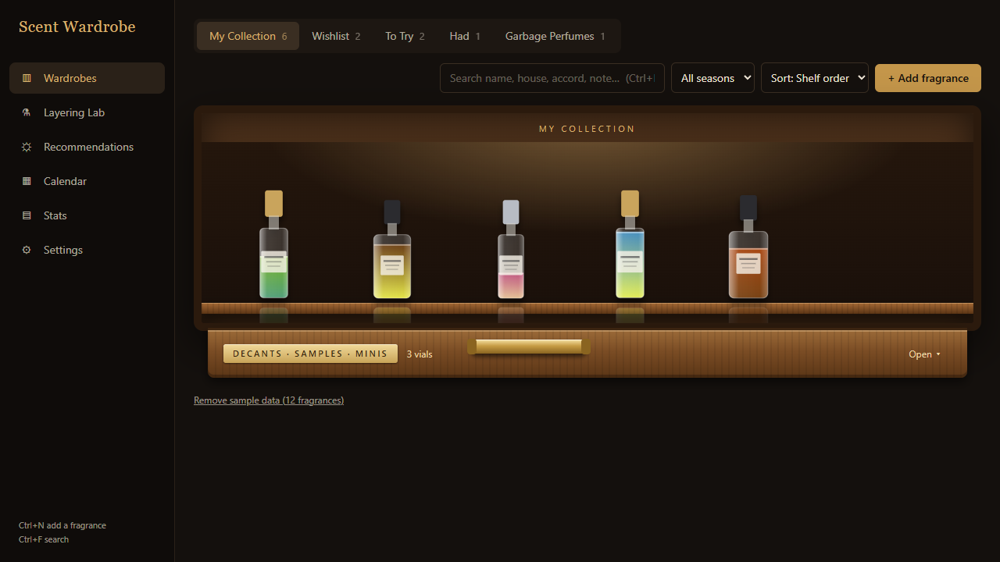
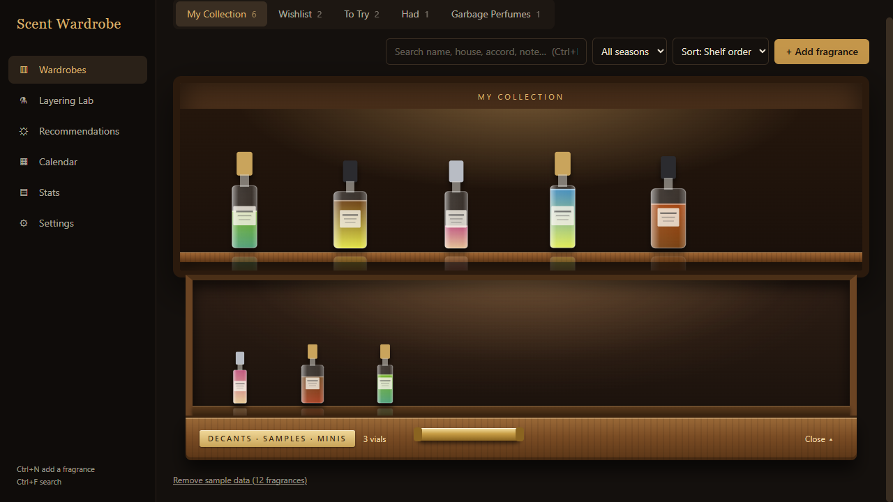
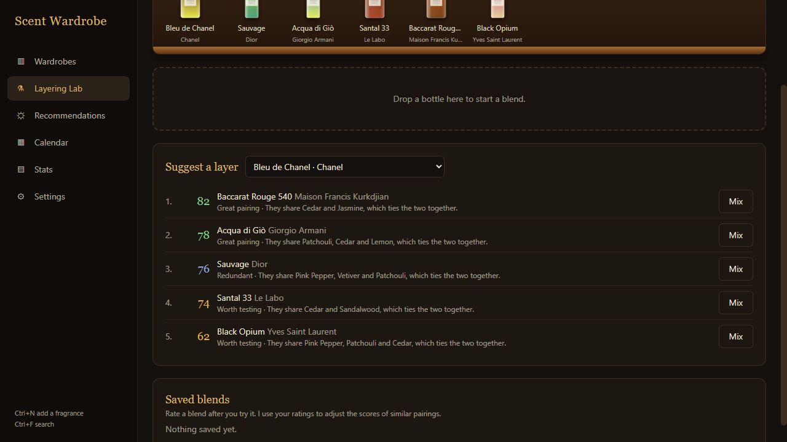
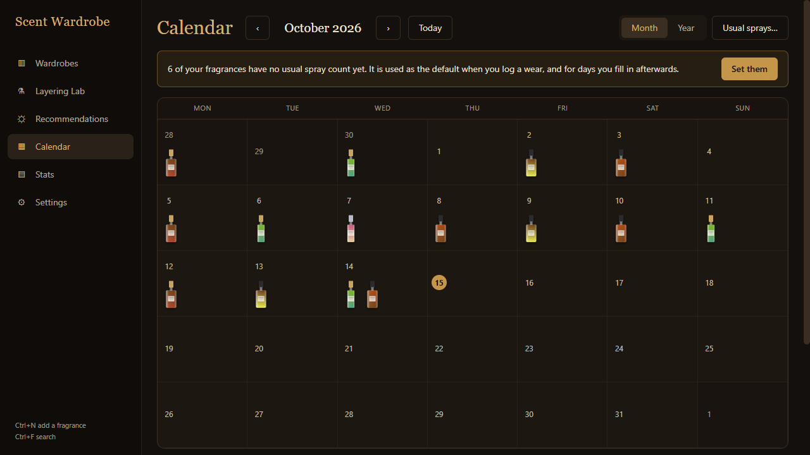
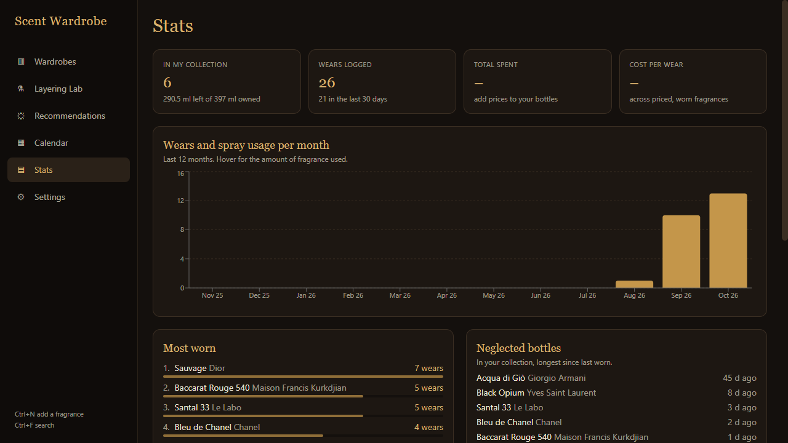
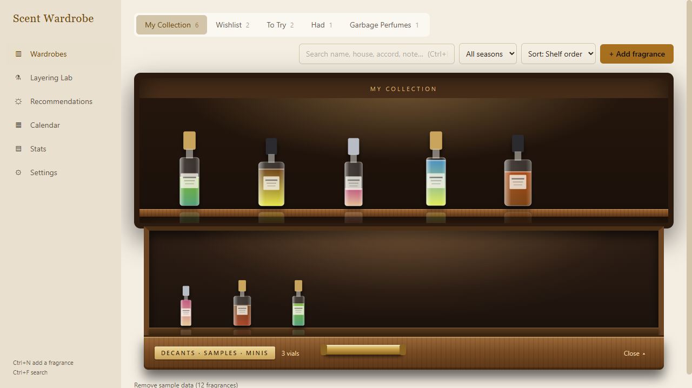

# Scent Wardrobe

**A personal, offline fragrance collection manager for the desktop.** Your bottles sit on virtual shelves at their real size, with a liquid level that drops as you wear them. Log what you wore in a calendar diary, see how each scent performs on *you*, let a layering engine predict how two fragrances will smell together, and get a recommendation for today from the weather and your plans. One user, no accounts, no cloud: your library is a single SQLite file on your own computer.

Built with Electron, React, TypeScript and SQLite. Runs on Windows and macOS (Intel and Apple Silicon).



<table>
  <tr>
    <td></td>
    <td></td>
  </tr>
  <tr>
    <td></td>
    <td></td>
  </tr>
  <tr>
    <td></td>
    <td></td>
  </tr>
</table>

*All screenshots use the app's built-in sample data.*

## Features

- **Five wardrobes**, each with its own look: **My Collection** (warm oak shelves), **Wishlist** (dark glass), **To Try** (light display shelving), **Had** (a sepia keepsake cabinet with years, memories and why it left) and **Garbage Perfumes** (a dumpster, with a note on why you dislike it). Drag bottles to reorder; sort and filter by season; search by name, house, accord or note. Moving a fragrance keeps its wears, bottles and notes.
- **Shelf and drawer.** Bottles are drawn to scale with a live liquid level. Samples, decants and minis live in an animated drawer, including vials of fragrances you only *want*.
- **Wear log and diary.** Sprays, activity, weather, projection, longevity, compliments. A wear takes sprays out of the bottle you chose and asks "How long did it last?" at the end of the day. Wears you add for past days are diary entries that leave bottle levels alone.
- **Calendar.** A month grid with a bottle thumbnail per day and a year heatmap. Click a day to see, edit, delete or add wears, including layered blends and fragrances that are not yours (marked "not mine").
- **Layering Lab.** Drag two or three bottles together, set the spray ratio and see a blended accord chart, a predicted description and a 0-100 compatibility score with reasons. The scoring adjusts to the combinations you rate.
- **Recommendations.** Activity, time of day and live weather give your top three picks with an explanation, a one-click "Wear this" and a layering idea.
- **Stats.** Most and least worn, wears and ml per month, leaderboards, bottles running low, cost per wear.
- **Prices and currency.** Per bottle: what you paid and a market price you looked up (with date and where), price per ml, how much you saved or overpaid. Pick your currency in Settings.
- **Adding fragrances.** Fuzzy search over your library and an optional imported dataset, a single Fragrantica page link, a whole Fragrantica profile (Have / Want / Had / custom shelves) with a preview first, a pasted list or CSV, or a manual form.
- **Safety.** Zip backup and restore, a weekly automatic backup, CSV export, light and dark themes.

Details for each feature are in [INSTRUCTIONS.md](INSTRUCTIONS.md).

## Engineering notes

This project is as much about how it is built as what it does.

- **Typed IPC contract.** The renderer never touches the database. It calls `window.api`, whose shape is one TypeScript interface in `src/shared/ipc.ts`; a mapped type forces every method to have a handler in the main process and an entry in the preload script, so a missing one is a compile error. Every call is checked to come from the app's own page.
- **SQLite with versioned migrations.** Eight migrations (`PRAGMA user_version`), each run in a transaction. Rules that must never be broken, such as the wishlist note, are enforced by database triggers as a last line of defence behind the API. A test builds a library at *every* schema version and upgrades it to the current one without losing a row.
- **Pure engines.** The layering and recommendation logic are framework-free TypeScript in `src/shared`, tested without Electron or a database.
- **Careful data handling.** Backups use SQLite's online backup (WAL-safe), restores validate the archive (size limits, integrity check, version check) and swap the file in atomically with a safety copy first, imports skip duplicates and survive damaged lines, and a database from a *newer* app version is refused rather than silently downgraded.
- **Security posture.** `contextIsolation` and sandbox on, no Node in the renderer, a strict Content-Security-Policy, navigation and pop-ups locked down, a path-safe image protocol, downloads limited to Fragrantica's own hosts with size and time caps, CSV export that neutralises spreadsheet formulas, and web content from importers treated as untrusted (length limits, no scripts, no permissions).
- **Accessibility and layout.** Dialogs trap focus, Escape closes only the top layer, muted text meets WCAG AA contrast in both themes (checked with axe-core), and the UI is checked from 1100x640 up.
- **Automated tests: 344 tests in 32 files**, run under Electron's own Node so the native SQLite module matches. They cover migrations, wear and bottle logic, backup and restore, the importers (including hostile input), both scoring engines, the calendar maths (including daylight-saving boundaries), price rounding, security helpers and performance with a 400-fragrance, 6,000-wear library.

## Tech stack, and why

| Choice | Why |
| --- | --- |
| **Electron** | A real desktop app with a local file database and no server, the same code on Windows and macOS. |
| **React + TypeScript** | Components for the shelf, dialogs and pages; strict types shared between main process and UI. |
| **electron-vite** | One build setup for the main process, the preload script and the renderer, with fast hot reload. |
| **Tailwind CSS 4** | A small set of theme tokens (ink, brass, cream) that flip between dark and light. |
| **better-sqlite3** | Synchronous, fast, transactional SQLite in the main process; one file is easy to back up. |
| **dnd-kit** | Accessible drag and drop for the shelves and the Layering Lab. |
| **Recharts** | The stats and accord charts. |
| **Vitest** | Fast tests for the pure engines and the database layer. |
| **electron-builder** | NSIS installer for Windows, DMGs for macOS. |

## Architecture

```
┌───────────────────────── Electron ─────────────────────────┐
│  main process (Node)                 renderer (Chromium)    │
│  ┌──────────────────────┐  typed IPC  ┌──────────────────┐  │
│  │ db/ (SQLite, wears,  │◄───────────►│ React pages and  │  │
│  │ stats, migrations)   │  preload    │ components       │  │
│  │ data/ (dataset       │  contextBridge│ lib/ (calendar, │  │
│  │ import, search)      │             │ money, shelf)    │  │
│  │ fragrantica/ (import)│             └──────────────────┘  │
│  │ backup, images, ipc  │                                    │
│  └──────────────────────┘      src/shared: types, the IPC    │
│                                contract, layering and        │
│                                recommendation engines        │
└─────────────────────────────────────────────────────────────┘
```

## Project structure

```
src/main/       main process: database and migrations (db/), dataset import and search (data/),
                Fragrantica import (fragrantica/), backup, images, security helpers, IPC handlers
src/preload/    the contextBridge API
src/renderer/   React app: pages/, components/, lib/
src/shared/     types, the IPC contract, the layering and recommendation engines
build/          app icon (generated by scripts/make-icon.cjs)
docs/           screenshots and development notes
scripts/        test runner, icon generator, third-party notice generator
```

## Download and install

Get the installer for your system from the [Releases](https://github.com/MedinaPiRRy/ScentWardrobe/releases) page:

| System | File |
| --- | --- |
| Windows 10/11 (64-bit) | `Scent-Wardrobe-Setup-<version>.exe` |
| macOS, Intel | `Scent-Wardrobe-<version>-mac-x64.dmg` |
| macOS, Apple Silicon (M1 and later) | `Scent-Wardrobe-<version>-mac-arm64.dmg` |

The installers are **not code-signed**, so Windows SmartScreen and macOS Gatekeeper warn the first time you open the app. That is expected; [INSTRUCTIONS.md](INSTRUCTIONS.md#installing) explains how to open it safely on each system.

## Build from source

You need Node.js 22 or newer. On Windows, the Visual Studio C++ build tools may be needed if a prebuilt SQLite module is not available; on macOS, the Xcode command line tools.

```
npm ci             # installs and rebuilds better-sqlite3 for Electron
npm run dev        # run the app with hot reload
npm run typecheck
npm test           # the full suite
npm run build      # production build into out/
npm run dist:win         # Windows installer into dist/
npm run dist:mac:arm64   # macOS DMG (run on a Mac; use dist:mac:x64 for Intel)
```

More in [docs/DEVELOPMENT.md](docs/DEVELOPMENT.md). Pushing a tag such as `v1.0.0` makes GitHub Actions build all three installers and attach them to a release.

## Privacy

Your library never leaves your computer. The only network traffic is: current weather and city search from [Open-Meteo](https://open-meteo.com) (only the coordinates of the city you pick are sent), and Fragrantica pages and pictures when *you* ask for an import. There is no account, telemetry or analytics.

## Credits and licence

Fragrance data and pictures come from [Fragrantica](https://www.fragrantica.com) and belong to their owners; this project is not affiliated with or endorsed by Fragrantica, and no Fragrantica content is included in the repository. See [NOTICE.md](NOTICE.md) for data credits, the dataset note and the importer's terms-of-use caveat, and [THIRD_PARTY_NOTICES.md](THIRD_PARTY_NOTICES.md) for open-source dependencies.

The code is released under the [MIT licence](LICENSE).
